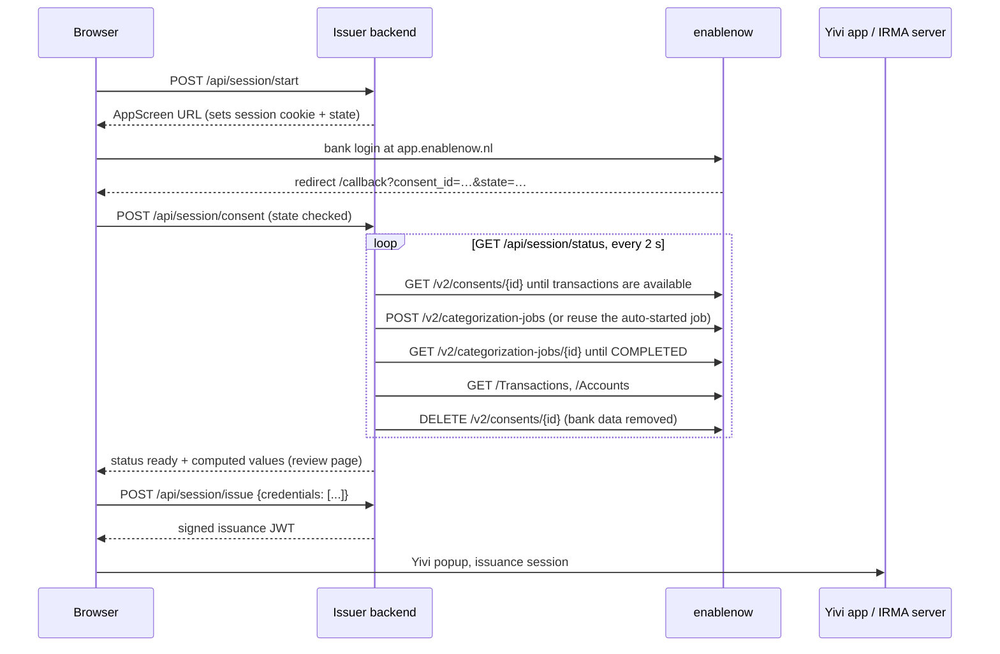

# PSD2 issuer

Issues Yivi credentials about a user's finances, derived from their own bank
transactions. The user connects a bank account through
[enablenow](https://docs.enablenow.nl) (a licensed PSD2 account information
service), enablenow categorizes the transactions with its
[E1 engine](https://docs.enablenow.nl/categorization/engines/e1-engine/categories),
and the issuer turns the categories into a set of small credentials. The user
reviews the values and chooses which ones to add to the Yivi app.

Built on the same layout as [go-sms-issuer](https://github.com/privacybydesign/go-sms-issuer):
a Go backend (`backend/`) serving a React frontend (`frontend/`), signing
issuance requests for an IRMA server.

## Credentials

The credentials mirror the
[E1 data model](https://docs.enablenow.nl/categorization/engines/e1-engine/categories):
one credential per E1 (retail) top-level group, with one attribute per E1
category code. The attribute id is the code below the group without
separators, e.g. `income.pension.state` becomes `income.pensionstate` and
`expense.transport.public_transport` becomes `transport.publictransport`. A
verifier asks for (and the user discloses) only the attributes it needs.

Every amount is the **signed net** monthly average in whole euros over the
last 12 **full** calendar months, rounded to the nearest 10 (configurable):
positive means received, negative means paid, so `housing.rent` is `-1050`
and two-way categories such as `alimony.other` or `investment.savings` keep
their direction. The current, incomplete month is not used. When the bank
returns less history, the first partial month is skipped and `months` tells
how many months the averages are based on. No values are derived: no totals,
yes/no flags or classifications.

| Credential (`irma-demo.enablenow.*`) | E1 group | Attributes |
|---|---|---|
| `income` | `income.*` | `rent`, `salary`, `pensionstate`, `pensionprivate`, `pensionother`, `other` |
| `housing` | `housing.*` | `rent`, `mortgage`, `other` |
| `subsidy` | `subsidy.*` | `family`, `familyincome`, `health`, `disability`, `social`, `socialother`, `rent`, `unemployment`, `student`, `other` |
| `loan` | `loan.*` | `debtcollection`, `student`, `flash`, `bnpl`, `creditcard`, `vehiclelease`, `private`, `other` |
| `alimony` | `alimony.*` | `other` |
| `insurance` | `insurance.*` | `health`, `vehicle`, `life`, `other` |
| `tax` | `tax.*` | `income`, `vehicle`, `corporate`, `payroll`, `social`, `vat`, `other` |
| `cash` | `cash.*` | `other` |
| `gambling` | `gambling.*` | `lottery`, `other` |
| `investment` | `investment.*` | `savings`, `crypto`, `pension`, `other` |
| `essential` | `expense.essential.*` | `groceries`, `utilitiesenergy`, `utilitieswater`, `utilitiesother`, `childcare`, `clothing`, `medical`, `personalcare`, `education`, `financial`, `telecom`, `municipal`, `other` |
| `transport` | `expense.transport.*` | `publictransport`, `fuel`, `vehicle`, `parking`, `other` |
| `lifestyle` | `expense.lifestyle.*` | `restaurantsbars`, `streaming`, `subscriptions`, `sports`, `culture`, `travel`, `donations`, `pets`, `other` |
| `expense` | `expense.*` | `salary`, `other` |
| `other` | `other.*` | `fines`, `privatetransfer`, `other` |
| `bankaccount` (one per account) | accounts of the consent | `iban`, `accountholder`, `bank` |

All credentials except `bankaccount` also carry `months`, `periodstart` and
`periodend`. Credentials expire after 90 days (`credential_validity_days`),
because financial data goes stale.

Each code counts only itself: `subsidy.family` does not include
`subsidy.family.income`. Refunds and reversals keep the category of the
original payment and repaid benefits keep the benefit category, so both are
netted. Internal transfers (`internal.other`), corporate-only codes and
transactions in other currencies, without an E1 category or below
`min_confidence` are ignored. E1 flags are not used.

All credential and attribute definitions, with English and Dutch texts, live
in [`backend/credentials/definitions.json`](backend/credentials/definitions.json).
The backend embeds it, `scheme/generate.py` generates the scheme from it, and
the frontend loads it from `GET /api/definitions`.

The scheme definitions in [`scheme/`](scheme/) are generated by
`python3 scheme/generate.py scheme --logos`. They are part of the
`irma-demo` scheme since
[irma-demo-schememanager#183](https://github.com/privacybydesign/irma-demo-schememanager/pull/183)
(with issuer keys). After changing attributes, regenerate both copies
(`python3 scheme/generate.py <path-to-irma-demo-schememanager> --logos`) and
re-sign that scheme.
`backend/scheme_test.go` fails when the scheme and the computed attributes
drift apart.

## Flow



The flow is driven entirely by the status polls: there are no background
workers, and any instance can handle any request because sessions live in
Redis. Once the credentials are computed the consent is deleted at enablenow
(unless `keep_consent` is set), and the session with the computed values
expires after 30 minutes or when the user finishes.

## Demo verifier

`/<lang>/verifier` (e.g. `/nl/verifier`) is a demo verifier that gives an
indication of eligibility for social security schemes. The user chooses a
law, and the verifier asks with Yivi for exactly the attributes that law
needs (all required) plus the date of birth, from which the age group and
the state pension age (art. 7a AOW) follow. `bijstand` and `minima` also
ask for the postcode of the address card, to check that the applicant
lives in the municipality (art. 40 Participatiewet); the demo accepts any
postcode. The household (partner,
cost-sharing housemates) is not in a credential yet, so the user declares
it. The laws live in [`backend/rules`](backend/rules) (`rules.Laws`) and
follow the texts in [regelrecht-corpus](https://github.com/MinBZK/regelrecht-corpus),
using the versions in force on the day of the check:

| Law (`rules.Laws`) | Rules | Outcome |
|---|---|---|
| `bijstand` | Participatiewet: income per art. 31, 32; norm per art. 21, 22 or the cost-sharing norm of art. 22a | norm minus income; from the state pension age the AIO supplement |
| `minima` | as `bijstand` | income at most 120% of the norm (example; every municipality sets its own limit) |
| `kwijtschelding_gemeente` | Uitvoeringsregeling Invorderingswet 1990, art. 11-16 and 27-28: net disposable income (art. 14) minus housing costs above the basishuur of the Wet op de huurtoeslag, paid taxes and alimony, the health premium minus the normpremie and the zorgtoeslag (art. 15), and childcare minus the allowances, as the demo municipality has decided (art. 28.3), minus 90% of the norm as cost of living (art. 16) | no payment capacity: full remission; otherwise at most 80% of 12 months of payment capacity is paid (art. 11), the rest of the assessment is remitted |
| `kwijtschelding_hhnk` | as `kwijtschelding_gemeente`, without childcare and with 100% of the norm as cost of living (Kwijtscheldingsregeling waterschapsbelastingen HHNK 2023) | as above; pensioners are not evaluated (art. 2.2 refers to a regulation that is not in the corpus) |

Attributes that do not count are not asked for: e.g. the Awir allowances
for bijstand (art. 31.2.d) and the individuele inkomenstoeslag for
kwijtschelding (art. 14.1.c). For kwijtschelding the zorgtoeslag and, for
the municipality, the kinderopvangtoeslag (`subsidy.family`, together with
the kindgebonden budget) are asked for because they lower the costs. `GET
/api/verifier/laws` lists what each law asks for, which the page shows
before the user shares anything.

The result is an indication, not a decision. Not checked are: assets
(art. 34 Participatiewet, art. 12 Uitvoeringsregeling), the youth norms
(art. 20), the exclusion grounds of art. 13, the income of a partner who is
not on the disclosed cards and the cost of living of children
(art. 15.1.g: it needs the number of children). The amounts are
12-month averages, not the income per month or the expected income of the
coming 12 months.

The norms are copied from the corpus: `rules.Versions` (Participatiewet,
every 1 January and 1 July) and `rules.KwijtscheldingVersions` (maximum rent,
basishuur and normpremie, every 1 January) need a new entry when the amounts
change;
until then the last version keeps being used.

The backend starts the disclosure session at the IRMA server (as requestor
`issuer_id`, signed with the same key) and fetches the result itself, so the
browser never sees the requestor token and cannot alter the disclosed values;
the date of birth is not returned to the browser. It is off unless
`demo_verifier.enabled` is set. The IRMA server requestor then also needs
`disclose_perms` for `irma-demo.enablenow.*`, the date of birth attribute
and the postcode attribute (see below).

## Running locally

Without enablenow credentials, set `"enablenow_backend": "fake"`: the
AppScreen is skipped and a year of synthetic transactions is used.

```bash
# keys: the issuer signs with priv.pem, the IRMA server verifies with pub.pem
mkdir -p local-secrets/psd2-issuer local-secrets/irma-server
openssl genrsa 4096 > local-secrets/psd2-issuer/priv.pem
openssl rsa -in local-secrets/psd2-issuer/priv.pem -pubout > local-secrets/irma-server/pub.pem
cp config.example.json local-secrets/psd2-issuer/config.json   # then edit it

# frontend
cd frontend && npm ci && npm run build && cd ..

# backend (serves ../frontend/build)
cd backend && go run . --config ../local-secrets/psd2-issuer/config.json
```

For frontend development, run `npm run dev` in `frontend/` (port 3000, `/api`
is proxied to the backend on 8080).

### Docker Compose

```bash
cp .env.example .env   # set REDIS_PASSWORD, and the same password in config.json
docker compose up
```

## Configuration

See [`config.example.json`](config.example.json).

- `public_url`: externally reachable base URL. The AppScreen redirects back to
  `<public_url>/callback`; register that URL as redirect URI in the enablenow
  Management Portal. Session cookies are `Secure` when it starts with `https://`.
- `credential_prefix` builds the credential ids (`<prefix>.income`, ...);
  `credentials` can override single ids, e.g.
  `{"income": "pbdf.enablenow.income"}`.
- `enablenow_backend`: `enablenow` or `fake`. `enablenow_config` holds the
  client id and secret (client credentials grant, scope `customer-api`) and
  optionally `api_url`, `app_url`, `token_url` and `scope`.
- `categorization`: E1 `profile` (`retail`, default, or `corporate`),
  `country_code` (`nl` or `be`), `months` (12), `rounding` (10),
  `min_confidence` (0) and `keep_consent` (false).
- `storage_type`: `memory`, `redis` or `redis_sentinel`.
- `demo_verifier`: `enabled` (false) turns on the demo verifier;
  `irma_server_url` is the IRMA server as reached from the backend (e.g.
  `http://irma:8088` in Docker Compose), by default `irma_server_url`;
  `date_of_birth_attribute` is the attribute the age comes from, by default
  `irma-demo.gemeente.personalData.dateofbirth` (e.g.
  `pbdf.gemeente.personalData.dateofbirth` in production);
  `postcode_attribute` is the attribute the municipality is checked on, by
  default `irma-demo.gemeente.address.zipcode` (e.g.
  `pbdf.gemeente.address.zipcode` in production).
- `trusted_proxies`: CIDR ranges of reverse proxies allowed to set
  `X-Real-IP`, used for rate limiting session starts (20 per IP per 30 min).

IRMA server requestor config (`local-secrets/irma-server/config.json`):

```json
{
    "requestors": {
        "psd2_issuer": {
            "auth_method": "publickey",
            "key_file": "/config/pub.pem",
            "issue_perms": [
                "irma-demo.enablenow.income",
                "irma-demo.enablenow.housing",
                "irma-demo.enablenow.subsidy",
                "irma-demo.enablenow.loan",
                "irma-demo.enablenow.alimony",
                "irma-demo.enablenow.insurance",
                "irma-demo.enablenow.tax",
                "irma-demo.enablenow.cash",
                "irma-demo.enablenow.gambling",
                "irma-demo.enablenow.investment",
                "irma-demo.enablenow.essential",
                "irma-demo.enablenow.transport",
                "irma-demo.enablenow.lifestyle",
                "irma-demo.enablenow.expense",
                "irma-demo.enablenow.other",
                "irma-demo.enablenow.bankaccount"
            ],
            "disclose_perms": [
                "irma-demo.enablenow.*",
                "irma-demo.gemeente.personalData.dateofbirth",
                "irma-demo.gemeente.address.zipcode"
            ]
        }
    }
}
```

## API

| Endpoint | |
|---|---|
| `GET /api/definitions` | credential and attribute definitions with translations |
| `POST /api/session/start` | new session; returns `{url}` of the AppScreen and sets the session cookie |
| `POST /api/session/consent` | `{consent_id, state}` from the redirect |
| `GET /api/session/status` | advances the flow; `{status, error?, credentials?}` with status `awaiting_consent`, `awaiting_transactions`, `categorizing`, `ready` or `failed` |
| `POST /api/session/issue` | `{credentials: ["income", ...]}`; returns `{jwt, irma_server_url}` |
| `DELETE /api/session` | forget the session (and delete an in-progress consent) |
| `GET /api/verifier/laws` | demo verifier: the laws with the attributes each asks for |
| `POST /api/verifier/start` | demo verifier: `{law, household: {partner, partner_pension_age, housemates}, tax_assessment?}`; returns `{sessionPtr, frontendRequest}` and sets the verifier cookie |
| `GET /api/verifier/result` | demo verifier: fetches the disclosure from the IRMA server and returns `{household, age_group, tax_assessment, evaluation}` |

Errors are plain-text codes such as `error:session-not-found`,
`error:bank-connection`, `error:no-transactions` or `error:timeout`.
